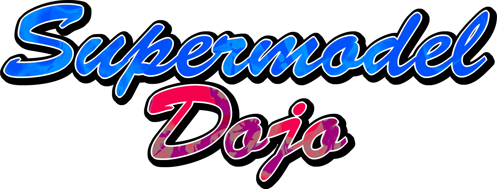

<p align="center"><br /><i>Logo Credit: <a href="https://www.deviantart.com/mkfan12">@Frosted_Moontips</a></i></p>
<h1 align="center">Supermodel Dojo</h1>

**Supermodel Dojo** is a fork of [**Supermodel**](https://github.com/trzy/Supermodel), a Sega Model 1/2/3 emulator, with a focus on netplay features, replay, and training options for competitive play.  We intend to keep **Supermodel Dojo** updated with the latest upstream changes made to the parent project.

# Netplay & Replay Supported Games

Currently, Supermodel Dojo's __netplay & replay__ functionality supports games that use 2 joysticks with digital buttons on the same cabinet, and analog light gun games. These games include:

## Model 3

### Two Joysticks & Digital Buttons

* Virtua Fighter 3 (`vf3`, `vf3a`, `vf3c`)
* Virtua Fighter 3 Team Battle (`vf3tb`)
* Fighting Vipers 2 (`fvipers2`, `fvipers2o`)
* Virtua Striker 2 (`vs2`, `vs215`, `vs215o`)
* Virtua Striker 2 '98 (`vs298`, `vs29815`)
* Virtua Striker 2 '99 (`vs299`, `vs299a`, `vs29915a`)
* Virtua Striker 2 '99.1 (`vs2v991`, `vs299j`, `vs29915`, `vs29915j`)

### Analog Light Guns

* The Lost World: Jurassic Park (`lostwsga`, `lostwsgp`)
* The Ocean Hunter (`oceanhun`, `oceanhuna`)
* L.A. Machineguns: Rage of the Machines (`lamachin`)

## Model 2

### Two Joysticks & Digital Buttons

* Virtua Fighter 2 (`vf2`, `vf2a`, `vf2b`, `vf2o`)
* Fighting Vipers (`fvipers`, `fvipersa`, `fvipersb`)
* Last Bronx (`lastbrnx`, `lastbrnxu`, `lastbrnxj`)
* Sonic the Fighters (`sfight`)
* Sonic Championship (`schamp`)
* Dead or Alive (`doa`, `doaa`, `doaab`, `doaae`, `doab`)
* Dynamite Cop (`dynamcop`, `dynamcopb`, `dynamcopc`)
* Dynamite Deka 2 (`dyndeka2`, `dyndeka2b`)
* Dynamite Baseball (`dynabb`)
* Dynamite Baseball 97 (`dynabb97`)
* Virtua Striker (`vstriker`, `vstrikero`)
* Zero Gunner (`zerogun`, `zeroguna`, `zerogunaj`, `zerogunj`)
* Pilot Kids (`pltkids`, `pltkidsa`)
* Air Walkers (`airwlkrs`)
* Royal Ascot 2 (`rascot2`)
* Hanguk Pro Yagu 98 (`hpyagu98`)

### Analog Light Guns

* Gunblade NY (`gunblade`)
* Rail Chase 2 (`rchase2`, `rchase2a`)
* Behind Enemy Lines (`bel`)

## Model 1

### Two Joysticks & Digital Buttons

* Virtua Fighter (`vf`)

Crosshairs are on by default for gun games (Alt+I cycles them off).

Replay and netplay functionality is planned for all games with local multiplayer on the same physical cabinet.

# Replays

Session replay recording is enabled by default. To disable, be sure to disable the `RecordSession` option in `Supermodel.ini`, or in the in-emulator Settings Menu.

To load a replay, add the `-replay-file=` argument with the replay path included.

## Replay Takeover

You can watch your old replays and drop in at any time as either character to experiment with your strategy and execution.

When watching a replay, you can assume control over a player by pressing `Shift + 1` for player 1 o `Shift + 2` for Player 2. This will transfer you to Training Mode with the remainder of the replay playing out.

# Training Mode

Supermodel Dojo's Training Mode lets you record, playback, and loop movements on training dummies you can cycle through with a "Switch Player" button.

To open via the command line, add the `-train` argument when you load a game.

Switch Player: `Shift + F7`
Record Slot (1-3): `Shift + (F1-F3)`
Record Slot (1-3): `Shift + (F4-F6)`
Toggle Playback Loop: `Shift + F9`

# Netplay

Netplay can either be done via the command line instructions below, or through the [Dojo Lobby](https://lobby.dojo.ooo/) matchmaking platform. Dojo Lobby takes care of the emulator defaults, matchmaking, hole punching, and fallback relay details for you, along the ability to share replays with other players. The latest version of Supermodel Dojo is bundled in the Dojo Lobby installer and kept up to date via the internal updater, ensuring that both players are on the same version.

## Netplay Session Notes

The following settings should be identical between host & guest player to prevent desyncs:
* PowerPC Frequency
* Refresh Rate
* Delay

A wired connection is preferred, and guarantees a smoother connection between you and your opponent.

# Command Line Examples
## Hosting Netplay Session
```supermodel.exe ROMs/vf3.zip -netplay -delay=1 -source-port=6000 -host```

## Joining Netplay Session
```supermodel.exe ROMs/vf3.zip -netplay -delay=1 -target-port=6000 -target-ip="127.0.0.1"```

## Manual Delay Calculation
To calculate delay, we would use the following formula:

`Ceiling( Ping / 2 * FrameDuration (16 ms) ) = Delay #`

For instance, if my opponent’s average ping is 42 ms, I would divide it by 32 ms (2 * 16 ms) and round it up to 2.

```
= Ceiling( 42 ms / 2*16 ms )
= Ceiling( 42 ms / 32 ms )
= Ceiling( 1.3125 )
= 2
```

If you or your opponent are on WiFi, or you have a fluctuating connection, be sure to bump the delay up a little bit to compensate for this.

## Build Instructions

### Windows

The preferred method for building Supermodel is to use GCC and MSYS2. After installing [MSYS2](https://msys2.org), open the MSYS2 shell and install the required dependencies using the pacman package manager:

- GCC (```mingw64/mingw-w64-x86_64-gcc```)
- Make (```mingw64/mingw-w64-x86_64-make```)
- SDL2 (```mingw64/mingw-w64-x86_64-SDL2```, ```mingw64/mingw-w64-x86_64-SDL2_net```)

This can be done using the following commands:

```
pacman -S mingw64/mingw-w64-x86_64-gcc
pacman -S mingw64/mingw-w64-x86_64-make
pacman -S mingw64/mingw-w64-x86_64-SDL2
pacman -S mingw64/mingw-w64-x86_64-SDL2_net
```

At this point, you can continue using either the MSYS2 shell or Windows Command Prompt but ensure that both ```gcc``` and ```mingw32-make``` are in your path. In MSYS2, the location of these binaries will be ```/mingw64/bin``` and for Command Prompt, assuming MSYS2 was installed in the default location, add ```C:\msys64\mingw64\bin``` to your Windows ```PATH``` variable.

Build the Supermodel Dojo emulator:
```
mingw32-make -f Makefiles/Makefile.Win32 NET_BOARD=1
```

You will find `supermodel` in the `bin` folder.

If you wish to build via Visual Studio 2026,
Make sure to run the Get_Libs.cmd files in the libraries directory. It will automatically pull in the required dependencies. Then either build inside the GUI or use the Build.cmd file in the MSVC folder.

### Linux

Ensure SDL2 is installed. Most package managers ought to have this available. For example, on Ubuntu, it should be sufficient to run:

```
sudo apt install libsdl2-dev
sudo apt install libsdl2-net-dev
```

Build the Supermodel Dojo emulator:
```
make -f Makefiles/Makefile.UNIX NET_BOARD=1
```

You will find `supermodel` in the `bin` folder.
